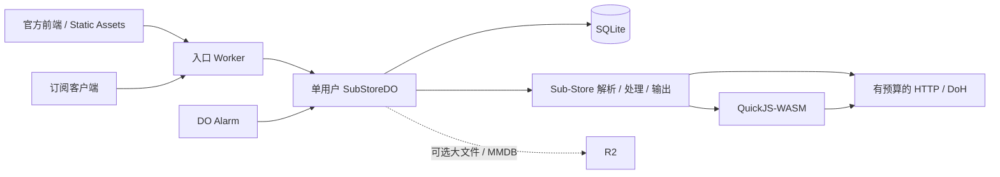

# Sub-Worker 架构

日期：2026-11-13。目标：单用户，常见规模约 100 节点，按 999 节点验收；优先使用 Workers Free。

本文件描述目标架构。当前可执行代码位于 `bench/`，只实现本地可行性原型。生产入口、鉴权整合、缓存失效与完整定时任务尚待实施。

## 运行拓扑



首版只需要一个业务 Durable Object，固定实例名。原型为了独立测试，把网络作业放在另一个 DO 中；目标实现把作业表和 Alarm 合并进同一业务 DO，不以增加实例数解决单用户负载。

入口 Worker 只做路径规范化、鉴权、静态资源路由与 DO 转发。解析、脚本、SQLite 读写与输出生成都在 DO 内，避免将这些工作放在普通免费 Worker 的 10 ms CPU 预算中。

DO 不等于“所有 await 之间自动串行”。首版显式维护请求队列；管理写入、生成任务和 Alarm 的状态变更都经过同一队列。构造阶段只做 schema 初始化与状态恢复，不把长期网络请求放进 `blockConcurrencyWhile`。每个网络批次最多 40 次请求、并发最多 4，防止一个大任务长期占用队列。

## 模块边界与接口

| 模块 | 责任 | 主要接口 |
| --- | --- | --- |
| `entry/worker` | 路由、身份与静态资源 | `fetch(Request, env)` |
| `state/sub-store-do` | 单一写入者、请求队列、恢复 | `fetch()`、`alarm()` |
| `storage/legacy-store` | 同步 read/write/delete、变更追踪与导入 | `read(key)`、`write(value,key)`、`flush()` |
| `core/sub-store-adapter` | 注册上游路由及平台能力 | `createApp(platform)` |
| `scripts/quickjs-runner` | 创建、桥接、执行和销毁脚本 VM | `execute({source,bindings,args,budget})` |
| `network/http-client` | 请求预算、超时、重定向与响应规范化 | `request(options, budget)` |
| `network/dns` | DoH 与现有解析器接口 | `resolve({server,domain,type})` |
| `cache/source-cache` | 原始订阅、内容摘要与 TTL | `loadSource()` |
| `cache/parsed-cache` | 按内容摘要复用归一化节点 | `loadParsed()` |
| `cache/output-cache` | 版本化的完整产物 | `loadOutput()`、`commitOutput()` |
| `jobs/scheduler` | 持久任务、检查点、重试与下次 Alarm | `enqueue()`、`runDueBatch()` |

上游源码固定在 `vendor/sub-store/`。平台差异集中在适配模块；构建期变换必须有唯一锚点断言，升级上游时锚点变化立即失败，不能静默打补丁。生产代码不能导入 `bench/metrics.mjs` 或开放 `/_bench/*`。

## 数据与一致性

SQLite 是配置、任务和产物的唯一事实来源。内存仅作有上限的缓存；`/tmp` 不承载任何需跨请求保存的数据。

首版保持原有领域桶与同步访问方式，降低迁移风险：

```sql
sub_store_data(key PRIMARY KEY, value_json)
sub_store_root(key PRIMARY KEY, value_json)
revisions(scope PRIMARY KEY, version)
source_cache(cache_key PRIMARY KEY, content, content_hash, expires_at)
parsed_cache(content_hash PRIMARY KEY, parser_version, nodes_json, bytes)
output_cache(cache_key PRIMARY KEY, revision, content, generated_at, expires_at)
jobs(id PRIMARY KEY, kind, spec_json, cursor_json, status, next_run_at, attempts)
geo_cache(query_key PRIMARY KEY, value_json, expires_at)
```

上游会出现“read 后原地修改对象”的调用方式，不能只把显式 write 接到数据库。保留现有变更追踪，在请求成功/失败收尾时有明确的写入策略。管理配置的一次逻辑修改与 revision 增长放在事务中；备份恢复先校验完整快照，再原子替换配置。

原型基线把单条值限制在 1,900,000 字节，目标首版先保留这一保守限制，不因为最新文档提高上限而未经验证地放宽。输入另设 1 MiB/来源、总节点 999 的默认保护，按实际字节数校验；超过上限返回明确错误，不截断节点。大型文件与 MMDB 后续通过 R2 处理。

## 三层缓存

1. **来源缓存**：key 包含来源 URL、影响响应的请求头和身份摘要；TTL 默认 5 分钟，可配置。密钥和完整带 token 的 URL 不写日志。
2. **解析缓存**：key 为输入内容 SHA-256 与解析器版本。存储归一化数据，避免未变化的 YAML 在每次下载时重新构造 AST。处理器拿到独立副本，防止一次重命名污染后续请求。
3. **产物缓存**：key 包含订阅/集合 revision、输入摘要、目标平台、规范化输出参数、脚本摘要与引擎版本。先鉴权再读缓存；不同分享权限或过滤参数不可误命中同一产物。

配置更新使旧 revision 的缓存逻辑失效。生成期间若配置 revision 改变，旧任务不能覆盖新版本产物。只有完整生成成功，才能在事务中切换当前产物指针。

保留两种执行方式：

- `live`：按原版习惯在下载时执行处理器。导入的含脚本配置默认使用此模式，保留 `$substore.write`、通知和 HTTP 等副作用的执行时机。
- `snapshot`：用户选择定时生成，下载读取最后一次完整成功的产物。失败保留上次有效结果并记录状态；没有可用产物时明确返回错误，不输出半成品。

不能把所有脚本自动视为纯函数。快照缓存对脚本副作用的影响必须由执行方式明确表达。内存缓存采用按字节限制的 LRU，首版总预算 16 MiB，避免无限保留所有来源和输出。

## 脚本契约与预算

桥接范围先覆盖 `$arguments`、`$options`、`$substore` 的读写/日志/HTTP、`ProxyUtils`、lodash、YAML、Buffer、缓存与 `produceArtifact`。Promise 返回值需驱动 QuickJS job queue。原地修改、错误栈、同步回调、嵌套产物和二进制值必须单独验证，不能以“支持 JavaScript”代替这些契约。

默认限制：

- QuickJS 单 VM 32 MiB、栈 512 KiB；同一请求的多个/嵌套 VM 另设总资源预算。首版未完成共享预算前，限制嵌套脚本，不开放无限递归。
- 使用**中断回调次数预算**，不把它标成精确指令数或毫秒。原型用 2,000 次回调，并证明在宿主与脚本 Date.now 都冻结时仍能打断死循环。
- 预算跨同一次脚本的异步续执行累计，不能每次 await 后重置。
- 每次业务调用最多 40 次实际网络尝试，包含来源拉取、脚本 HTTP、重定向、重试和 DNS；预留平台 50 次额度的余量。
- 网络并发默认 4、单次超时默认 8 秒；响应和 Buffer 桥接设置字节上限，不能把任意大二进制逐字节展开为 JS 对象。

脚本失败向 API 返回明确的结构化错误。原型已发现基线会捕获部分脚本错误并继续输出未修改节点，因此目标适配层必须接收显式错误信号；不靠扫描日志判断成功。

## 网络作业与调度

一个 DO 只有一个 Alarm。`jobs.next_run_at` 保存各任务时间，每次选择最早到期任务，处理一个有上限的批次，原子保存结果、cursor 和下一次 Alarm。Alarm 至少一次执行，使用任务 ID、配置 revision、批次 cursor 与结果主键保证重复执行不会重复生成记录。

999 个不同 IP 的查询需要 `ceil(999/40)=25` 批。Geo 缓存默认 24 小时，以查询类型、解析服务与 IP/域名为 key，先去重再发请求。短暂失败安排有限次数的退避重试；最终失败保存原因，避免无限唤醒和消耗额度。

**不能自动把任意用户 JS 分成 25 批并保存其执行栈。** 普通脚本超过 40 次请求应失败。大量查询应使用可恢复的“节点信息预处理”任务，完成后脚本读取缓存。需要服务端批量查询时，应选用真实支持批量接口的提供方，不能假定第三方免费 API 能承受 999 次调用。

原型的 Alarm 测试使用独立 `EnrichmentDO` 验证批次、缓存与重启恢复。该原型尚未实现完整任务类型、持久失败状态和所有重试策略。

## 功能边界

- 优先保留订阅/集合、格式转换、预览、分享、文件/产物、备份恢复与常用脚本。
- 固定与用户可配置任务都转为持久调度，不保留常驻 `setInterval` 或进程内 Cron。
- HTTP 推送、Gist 同步可以适配；外部副作用若没有幂等接口，不能承诺严格恰好一次。
- DoH 可用；TCP/TLS 需要逐项验证；任意 UDP DNS、子进程、本机 Mihomo/HTTP META 内核不在纯 Workers 等价范围内。
- 任意 `require`、本机路径和原生扩展不属于 QuickJS 的自动兼容能力。
- 999 节点首版不强制使用 R2；MMDB、大文件与其他存储服务按实际需要增加。

## 生产前验收边界

本地 CPU 是 workerd 整个子进程的 CPU 增量，非 Cloudflare 计费 CPU；本地内存限额不会按云端配置完整强制执行。上线前仍需在真实 Free 账号检查入口 Worker CPU、DO CPU、isolate 峰值内存、网络子请求数与每日消耗。

参考：[Workers 限额](https://developers.cloudflare.com/workers/platform/limits/)、[DO 限额](https://developers.cloudflare.com/durable-objects/platform/limits/)、[DO 定价](https://developers.cloudflare.com/durable-objects/platform/pricing/)、[本地限额边界](https://developers.cloudflare.com/workers/wrangler/configuration/#limits)、[计时器行为](https://developers.cloudflare.com/workers/runtime-apis/performance/)、[Alarms](https://developers.cloudflare.com/durable-objects/api/alarms/)。
